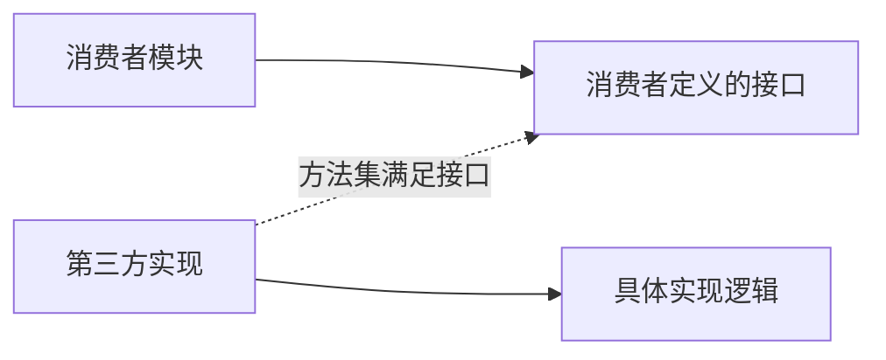
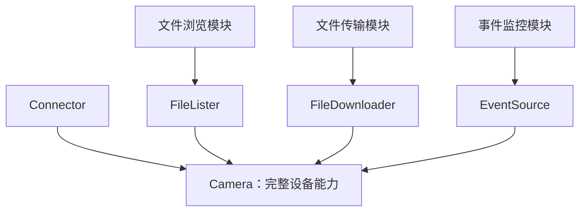
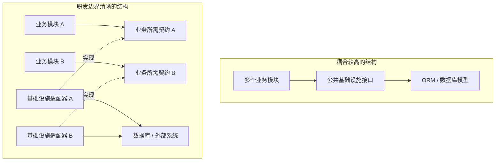
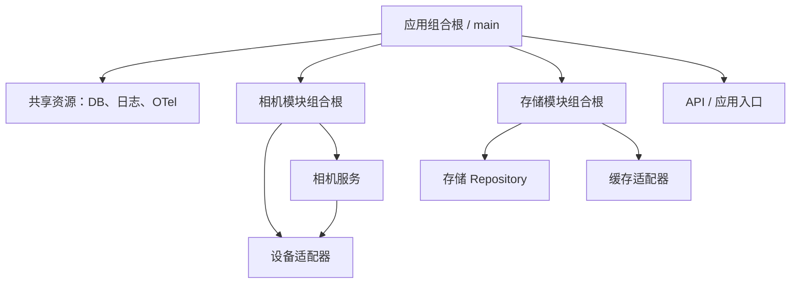
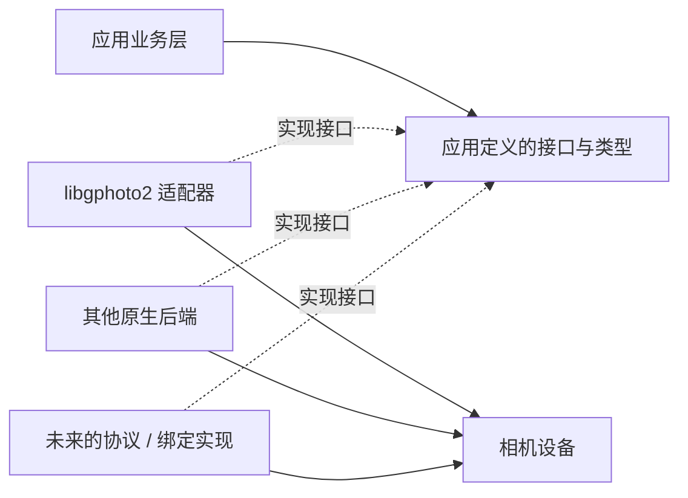

# Go 接口设计的边界：从消费者定义接口到组合根

> 接口设计的核心不是抽象出多少方法，而是明确谁需要什么能力、依赖关系应该指向哪里，以及系统未来应该以什么成本演进。

## 一、引言：接口设计真正困难的是什么？

在 Go 项目中，接口设计经常会引发几个问题：

- 接口应该由实现方定义，还是由使用方定义？
- 一个接口应该只包含一个方法，还是应该包含一组完整的业务能力？
- Go 的隐式接口实现，相比 Java 的显式 `implements`，究竟带来了什么价值？
- CRUD 接口是否会限制系统演进？
- 既然 Go 推崇显式依赖，是否意味着不应该使用 IoC 容器、注册表等机制？
- 当一个模块可能存在多种底层实现时，如何让业务逻辑不依赖具体技术？

这些问题看似分散，实际上都指向同一件事：

**如何划分依赖边界，使接口能够准确表达使用方的需求，同时避免实现细节向整个系统扩散。**

本文从接口设计出发，逐步讨论接口组合、依赖倒置、组合根，以及这些思想在真实项目中的应用。

---

## 二、接口应该由谁定义？

### 2.1 从使用方的需求出发

假设我们有一个文件导出模块，需要将业务数据导出到不同格式。

最初可能会设计一个通用导出接口：

```go
type Exporter interface {
    Export(data any) error
}
```

但随着业务发展，我们发现导出操作需要处理大量数据，不能一次性将全部数据加载到内存中。于是接口可能需要支持流式处理。

```go
type Exporter[T any] interface {
    Export(
        ctx context.Context,
        w io.Writer,
        source iter.Seq[T],
    ) error
}
```

这里的变化并不只是参数从 `any` 变成了泛型，而是接口开始明确表达消费者真正需要的能力：

- 使用方决定输出目标；
- 使用方提供数据源；
- 导出器负责将数据转换成目标格式；
- 数据可以逐条产生，而不必全部驻留内存。

接口不再只是对某个实现类的抽象，而是对一种**消费契约**的描述。

### 2.2 为什么更推荐消费者定义接口？

假设我们有一个文件存储实现：

```go
type FileStore struct{}

func (s *FileStore) Save(name string, r io.Reader) error {
    return nil
}

func (s *FileStore) Delete(name string) error {
    return nil
}

func (s *FileStore) Stat(name string) (FileInfo, error) {
    return FileInfo{}, nil
}
```

某个业务模块只需要保存文件。

如果接口由存储实现方统一定义，业务模块可能会依赖一个包含 `Save`、`Delete`、`Stat` 等方法的公共接口。

但对这个业务而言，删除和查询文件元信息都不是必要能力。

消费者可以直接定义：

```go
type FileSaver interface {
    Save(name string, r io.Reader) error
}
```

此时，业务模块只依赖自己真正需要的能力。

这并不意味着实现方不能提供完整接口，而是说：

**实现方可以提供丰富的能力集合，消费者则应该按照自身需求建立依赖边界。**

### 2.3 小接口不等于单方法接口

这里需要区分一个容易被误解的概念。

所谓小接口，并不是把每个方法都拆成一个独立接口，而是让接口只包含一个内聚的、完整的能力集合。

例如：

```go
type FileReader interface {
    Open(name string) (io.ReadCloser, error)
    Stat(name string) (FileInfo, error)
}
```

如果某个消费者完成读取文件的业务确实同时需要 `Open` 和 `Stat`，那么将它们放在同一个接口里完全合理。

相反，如果把每个方法都拆成单独接口，可能导致接口数量膨胀，增加组合和理解成本。

因此，接口边界更应该依据以下因素确定：

1. **消费者需求**：谁在使用这组方法？
2. **能力内聚性**：这些方法是否共同完成一个明确的职责？
3. **变化原因**：这些方法是否通常因为相同的需求变化而变化？
4. **依赖成本**：消费者是否会因为不需要的能力而被迫修改？

方法数量只是表面指标，不能代替对职责和依赖关系的判断。

---

## 三、Go 隐式接口实现的真正价值

消费者定义接口并不是 Go 独有的思想。其他语言也可以采用面向接口编程和依赖倒置。

Go 的独特之处在于：**接口实现关系由方法集决定，而不要求类型显式声明自己实现了哪个接口。**

### 3.1 显式实现与隐式实现

在 Java 中，一个类型通常需要显式声明接口实现关系：

```java
interface FileSaver {
    void save(String name, InputStream input);
}

class FileStore implements FileSaver {
    public void save(String name, InputStream input) {
        // ...
    }
}
```

在 Go 中，提供相同方法集的类型可以直接满足接口：

```go
type FileSaver interface {
    Save(name string, r io.Reader) error
}

type FileStore struct{}

func (s *FileStore) Save(name string, r io.Reader) error {
    return nil
}
```

`FileStore` 不需要声明 `implements FileSaver`。

这意味着，消费者可以在自己的包内定义接口，而不需要让底层实现包提前知道这个接口的存在。

### 3.2 这种机制解决了什么问题？

假设 `FileStore` 来自一个第三方库。

消费者现在需要一个只包含 `Save` 方法的接口，但第三方库原本没有提供这个接口。

在 Go 中，消费者可以直接定义它：

```go
package report

type Saver interface {
    Save(name string, r io.Reader) error
}
```

只要第三方类型的方法集满足该接口，就可以直接使用，不需要修改第三方代码，也不必为了满足接口专门编写一个转发适配器。

这种设计降低了接口定义与实现之间的耦合。



消费者定义契约，第三方类型提供能力。双方不需要相互导入对方的包，也不需要提前约定一个统一的接口类型。

### 3.3 隐式实现不代表没有契约

隐式接口实现也有边界。

首先，方法签名仍然必须匹配。新增接口方法后，原有类型可能不再满足该接口。

其次，方法名和签名匹配不代表语义一定正确。例如，两个 `Close()` 方法可能分别表示关闭一个文件和关闭整个设备会话，其生命周期语义并不相同。

因此，隐式实现解决的是**类型层面的耦合**，而不是自动解决语义契约。

接口仍然需要明确：

- 方法的输入输出含义；
- 错误语义；
- 并发调用约束；
- 生命周期和资源所有权；
- 操作失败后的状态。

### 3.4 Go 与 Java 的差异应该如何理解？

不能简单地认为 Java 无法做到消费者定义接口，或者无法实现接口组合。

Java 同样可以：

- 将接口定义在消费者模块；
- 通过构造函数注入依赖；
- 使用适配器隔离第三方实现；
- 将多个接口组合成更高层的契约。

区别主要在于：Java 的类型需要显式声明实现关系，因而消费者事后定义的新接口，通常不能直接让一个既有类型满足它，除非修改类型声明、增加适配器或使用其他包装方式。

Go 则允许消费者在不修改实现方的情况下，按照自己的需求重新描述一个能力边界。

**Go 的优势不是只有接口组合，而是接口组合与隐式实现共同降低了跨包、跨模块的适配成本。**

---

## 四、接口组合：从原子能力到业务契约

接口组合与消费者定义接口是两个不同的概念。

- 消费者定义接口，解决的是谁决定依赖契约。
- 接口组合，解决的是如何将多个能力组织成更高层的契约。
- 隐式实现，解决的是类型如何满足契约。

三者可以共同使用，但并不互相等价。

### 4.1 将能力拆分，再按需组合

例如，一个设备后端可能支持连接、文件枚举、文件下载和事件接收。

可以先定义四种能力：

```go
type Connector interface {
    Connect(ctx context.Context) error
    Close() error
}

type FileLister interface {
    ListFiles(ctx context.Context) ([]FileInfo, error)
}

type FileDownloader interface {
    Download(
        ctx context.Context,
        file FileInfo,
        dst io.Writer,
    ) error
}

type EventSource interface {
    NextEvent(ctx context.Context) (CameraEvent, error)
}
```

如果某个业务模块需要完整设备能力，可以组合它们：

```go
type Camera interface {
    Connector
    FileLister
    FileDownloader
    EventSource
}
```

而只负责文件浏览的模块，可以仅依赖 `FileLister`。



这里的 `Camera` 是一种方便的能力组合，不代表所有后端都必须实现全部能力。

如果未来某种设备协议只能枚举文件，却不支持事件通知，那么它依然可以被文件浏览模块使用，而不必为了满足一个过于宽泛的接口而伪造不支持的功能。

### 4.2 不要为了抽象而过度拆分

接口组合并不是拆得越细越好。

如果每个方法都对应一个接口，组合层可能出现大量没有独立业务意义的类型，消费者也需要理解过多抽象。

更合理的判断方式是：

> 如果一组方法通常由同一个消费者共同使用，并且共同表达一个完整职责，那么它们可以组成一个接口。

而当某项能力具有独立的使用场景、实现差异或演进节奏时，再将其独立出来。

### 4.3 可选能力应该如何表达？

有些设备支持实时预览，有些支持修改相机参数，有些则不支持。

这些能力可以独立定义：

```go
type LiveView interface {
    StartLiveView(ctx context.Context) error
    StopLiveView(ctx context.Context) error
}

type CameraControls interface {
    GetControl(ctx context.Context, name string) (ControlValue, error)
    SetControl(ctx context.Context, name string, value ControlValue) error
}
```

消费者可以依赖这些独立接口。若业务需要在运行时判断某个实例是否具备某项能力，也可以通过类型断言、能力描述对象或显式能力集合来实现。

需要注意，类型断言只适用于当前对象实际实现的接口。它不能替代对能力语义、运行条件和操作失败行为的定义。

---

## 五、CRUD 与基础设施抽象：问题不在 CRUD 本身

在讨论接口设计时，经常会出现一个观点：CRUD 接口会限制系统演进。

这个判断过于宽泛。

CRUD 本身只是常见的数据操作方式。对于大量业务，增删改查已经足够清晰，也没有必要为了追求抽象而引入复杂的领域模型。

真正值得关注的是：**系统是否将底层基础设施的接口变成了所有业务模块共同依赖的中心契约。**

### 5.1 CRUD 不是架构问题的根源

例如，一个仓储接口：

```go
type UserRepository interface {
    Create(ctx context.Context, user *User) error
    Get(ctx context.Context, id int64) (*User, error)
    Update(ctx context.Context, user *User) error
    Delete(ctx context.Context, id int64) error
}
```

如果用户管理业务确实需要这些操作，这个接口完全合理。

问题不在于它使用了 CRUD，而在于它是否被不加区分地用于所有场景。

假设一个业务只需要判断用户是否存在，却被迫依赖一个庞大的公共数据访问接口，那么这个接口就可能暴露了过多不必要的能力。

另一方面，如果所有业务都直接依赖数据库模型、ORM 查询对象和具体存储细节，那么更换数据库、修改数据组织方式或引入缓存时，就可能产生较大的传播范围。

### 5.2 应该关注依赖方向与变化范围



上图表达的是一种设计倾向，而不是要求每个业务都建立独立接口。

成熟项目应该根据真实的变化边界选择抽象粒度。多个业务如果确实共享稳定、内聚的契约，就可以共享；如果只是因为底层都使用同一个数据库，就把不同业务强行绑定到同一套接口，反而会增加耦合。

因此，评估 CRUD 或 Repository 设计时，可以重点检查：

1. 业务是否依赖了自己不需要的能力？
2. 数据库模型和 ORM 细节是否泄漏到业务边界之外？
3. 一个基础设施实现的变化是否会无差别地影响大量业务？
4. 公共接口是否真正表达稳定的业务需求，还是仅仅复制了底层 API？

**架构质量不取决于是否使用 CRUD，而取决于依赖是否合理、变化是否被限制在应有的边界内。**

---

## 六、IoC、依赖注入与组合根

接口设计解决了依赖什么，接下来还需要解决：具体实现由谁创建，依赖关系由谁组装？

这就涉及 IoC、DI 和组合根。

### 6.1 先区分三个概念

| 概念 | 主要含义 |
|---|---|
| IoC（控制反转） | 将部分控制权从业务对象转移到外部机制或更高层 |
| DI（依赖注入） | 将依赖对象从外部传入，而不是由对象自行创建 |
| IoC 容器 | 管理对象创建、依赖解析和生命周期的工具或机制 |
| 组合根（Composition Root） | 集中组装应用对象图的入口或边界 |

依赖注入不等于必须使用 IoC 容器。Go 中使用构造函数注入，也可以清晰地实现依赖倒置。

例如：

```go
type Service struct {
    store UserRepository
}

func NewService(store UserRepository) *Service {
    return &Service{
        store: store,
    }
}
```

`Service` 不负责创建数据库连接或具体 Repository，而是接收已经构建好的依赖。

这种方式简单、显式，也便于测试。

### 6.2 显式依赖不等于所有对象都由一个函数创建

小型项目可以由一个 `main` 函数直接完成所有组装。

但随着系统增长，如果全局组合根需要知道每个模块内部的 Repository、Service、Handler、缓存和适配器，最终会变成一个包含大量实现细节的巨型文件。

一种可行的方案是分层组合根，也可以称为树状组合根。

全局组合根负责应用级资源与模块之间的连接；模块内部再由自己的构造函数组装内部对象。



这个结构的关键不是增加更多构造函数，而是让组装职责与模块边界一致。

全局组合根知道有哪些模块，以及它们如何连接；相机模块的组合根知道相机服务内部需要哪些对象；存储模块的组合根知道存储实现的内部结构。

### 6.3 树状组合根的价值

它主要解决三个问题。

**第一，降低全局组装复杂度。** 全局入口不需要掌握所有内部对象。

**第二，保护模块边界。** 模块可以调整内部实现，只要保持对外的构造入口和业务契约稳定，上层通常不需要关心。

**第三，明确依赖与生命周期。** 数据库连接池、日志提供器等进程级资源由上层创建；模块内部对象由模块构造函数组装；资源关闭则由明确的生命周期管理逻辑负责。

这并不意味着 Java/Spring 无法做到相同的事情。Java 同样可以使用显式构造函数注入和模块化配置。Go 的常见取舍是优先采用普通函数和显式依赖，而不是默认依赖反射容器。

### 6.4 组合根与注册表不是同一种机制

注册表和组合根容易被混为一谈。

| 机制 | 解决的问题 |
|---|---|
| 组合根 | 创建哪些对象，以及对象之间如何连接 |
| 注册表 | 有哪些实现可供发现、选择或按标识获取 |
| 依赖注入 | 对象如何获得所需依赖 |
| 插件注册机制 | 扩展实现如何加入系统的可选实现集合 |

例如，一个配置中心通常是多个模块依赖的基础设施。它的实例由组合根创建并传入模块，往往比将其自动注册成全局单例更容易追踪依赖。

另一方面，如果系统确实需要支持可扩展的协议驱动、编解码器或策略实现，注册表可能是合理的选择。

因此，不应该简单地认为所有 `init()` 注册都是错误，也不应该把所有对象都放进全局注册表。

需要判断的是：这个机制究竟表达了什么关系，它是否让依赖和生命周期变得难以追踪。

---

## 七、工程案例：基于 libgphoto2 的相机后端抽象

前面的原则可以落到一个实际问题上：开发一套相机软件，当前通过 libgphoto2 访问相机，但未来可能替换为其他原生实现或能力更强的绑定。

如果应用代码直接依赖 libgphoto2 的类型、错误码、配置树和事件结构，那么底层实现就会逐渐变成整个应用的公共契约。

更合理的方式是：在应用边界定义自己的能力接口，由不同后端实现这些接口。

### 7.1 先识别业务能力，而不是照搬底层 API

当前可以将相机后端划分为四个职责：

1. 连接与关闭：管理设备会话生命周期；
2. 文件枚举：列出设备上的文件及其元信息；
3. 文件下载：将设备文件写入目标输出；
4. 事件接收：接收设备状态变化、文件变化等事件。

示例接口如下：

```go
type Connector interface {
    Connect(ctx context.Context) error
    Close() error
}

type FileLister interface {
    ListFiles(ctx context.Context) ([]FileInfo, error)
}

type FileDownloader interface {
    Download(
        ctx context.Context,
        file FileInfo,
        dst io.Writer,
    ) error
}

type EventSource interface {
    NextEvent(ctx context.Context) (CameraEvent, error)
}

type Camera interface {
    Connector
    FileLister
    FileDownloader
    EventSource
}
```

这里的 `FileInfo`、`CameraEvent` 应该是应用定义的类型，而不是直接暴露底层库的结构体。

这样做的目的是让应用围绕自身业务建立稳定契约，而不是围绕某个 C 库的 API 建立架构。

### 7.2 依赖关系应该如何组织？



这里的适配器负责将具体实现转换为应用契约：

- 把底层错误转换为应用可以理解的错误；
- 将底层文件信息映射为 `FileInfo`；
- 将底层事件映射为 `CameraEvent`；
- 隔离不同后端的资源管理与 API 差异。

需要强调的是，图中多个后端是可选的实现方向，并不代表它们一定能够支持完全相同的设备和协议。

### 7.3 为什么不要求所有后端实现全部能力？

假设未来有一种后端只支持文件列表和下载，却不支持主动事件通知。

如果应用只需要浏览和下载文件，那么它应该可以依赖：

```go
type FileAccess interface {
    FileLister
    FileDownloader
}
```

而不是要求这个后端实现完整的 `Camera`。

如果将来有一个设备监控模块确实需要事件，它再依赖 `EventSource`。

这可以避免为了统一接口而出现没有意义的空实现，例如某个后端的 `NextEvent()` 永远返回“不支持”。

### 7.4 接口签名之外，更重要的是语义契约

相机后端尤其需要明确生命周期和并发语义。

例如：

- `Close()` 是否会解除阻塞中的 `NextEvent()`？
- 连接失败后能否直接重试？
- 断开连接后，下载和事件读取分别返回什么错误？
- 同一时刻是否允许多个 goroutine 调用 `NextEvent()`？
- 如果事件通过 channel 暴露，关闭时如何终止发送，如何处理缓冲区已满？
- 文件标识是否只在当前会话有效？设备重连后是否仍然有效？

这些问题决定接口能否被可靠使用。

尤其要避免这样的情况：业务层认为关闭设备就会停止事件读取，但某个后端的底层调用无法被中断，最终导致 goroutine 泄漏。

因此，**接口不仅是一组方法签名，也是一份关于状态、错误、并发和资源生命周期的契约。**

### 7.5 什么时候需要能力描述对象？

如果只是由业务模块直接依赖某个接口，通常不需要额外的能力系统。

但如果应用 UI 需要动态显示“该设备支持实时预览”“该设备支持修改参数”，就需要一种运行时能力描述机制。

这时可以将能力探测与功能调用分开：

- 能力描述用于决定界面展示哪些功能；
- 接口用于表达调用方式；
- 实际调用仍然需要处理设备状态变化和操作失败。

不能把“实现了某个接口”简单等同于“该能力在当前状态下必然可用”。某些能力可能受设备型号、连接模式或运行状态影响。

---

## 八、几个延伸问题：接口边界如何处理真实业务变化？

### 8.1 导出器：不要让特殊格式决定公共接口

假设一个导出系统支持 CSV、Excel 和 JSON。

如果公共导出接口直接暴露 Excel 特有的工作表、单元格样式和合并单元格方法，那么这些特殊能力就会进入公共契约。

CSV 和 JSON 实现可能根本无法提供这些能力，最终出现空实现、条件判断或大量格式特有参数。

更合理的方式是区分：

- 所有格式都需要的最小公共导出能力；
- 仅特定格式支持的扩展能力；
- 业务层真正需要的格式特性。

不要为了让某一个实现方便，就将它的全部 API 推广为所有实现的共同契约。

### 8.2 接口演进：新增方法不是免费的

Go 的隐式接口实现降低了实现方与接口定义方之间的耦合，但并不意味着接口可以随意变化。

当消费者给接口增加方法后，原有实现类型可能不再满足接口。即使修改在语法上很小，也可能扩大实现方的适配成本。

因此，对外暴露的接口应该谨慎演进：

- 优先让接口保持内聚；
- 对可选能力采用独立接口；
- 避免将某个具体实现的特殊需求加入所有消费者共同依赖的接口；
- 在确实需要更高层组合时，再定义组合接口。

这并不是要求每次增加功能都创建新接口，而是要求先确认该功能是否属于现有契约的职责。

### 8.3 不要把接口当作架构的全部

即使接口划分得非常合理，系统仍然可能存在其他问题：

- 创建过程隐藏在全局状态中；
- 资源生命周期不明确；
- 错误处理依赖具体实现；
- 业务模块之间存在隐式调用关系；
- 适配器泄漏底层类型；
- 组合根承担了过多模块内部知识。

接口只是架构边界的一部分。要形成完整的设计，还需要结合构造方式、模块组织、生命周期和错误语义一起考虑。

---

## 九、总结：一套可复用的设计判断方法

回顾全文，可以将这些讨论归纳为几条原则。

### 原则一：从消费者的实际需求出发

不要先假设某个实现应该暴露怎样的公共接口，再让所有消费者适应它。

先看消费者需要什么能力，再定义稳定、内聚的契约。

### 原则二：小接口关注内聚性，而不是方法数量

一个接口可以包含多个方法，只要它们共同表达一项完整职责。

过大的接口会引入不必要的依赖，过度拆分则会制造没有实际价值的抽象。

### 原则三：理解 Go 隐式接口实现的价值

它让消费者可以在不修改实现方的情况下，定义新的能力边界。

但方法集匹配只是类型兼容，不能代替对语义、错误和生命周期的约定。

### 原则四：不要把 CRUD 本身当成架构问题

CRUD 是合理的常见模式。需要警惕的是公共基础设施契约过度扩张、底层实现细节泄漏，以及依赖关系导致的高传播成本。

### 原则五：显式依赖不要求全局掌握所有细节

组合根负责对象组装，模块内部构造函数负责内部依赖。树状组合根可以在保持显式依赖的同时，控制全局组装复杂度。

### 原则六：注册表和组合根各司其职

组合根决定对象如何创建与连接，注册表管理可发现、可选择的实现。是否使用注册表，应由扩展模型决定，而不是一概禁止或一概采用。

### 原则七：接口必须包含语义契约

连接、关闭、事件读取、文件下载等操作，除了方法签名，还需要定义并发、错误、状态变化与资源释放行为。

最终，接口设计并不是追求最少的方法、最多的抽象，或者最彻底的解耦。

它真正要解决的是：

**让每个模块只依赖自己需要的稳定能力，让实现细节能够独立变化，并让系统的依赖关系在规模增长后仍然可理解、可测试、可维护。**
